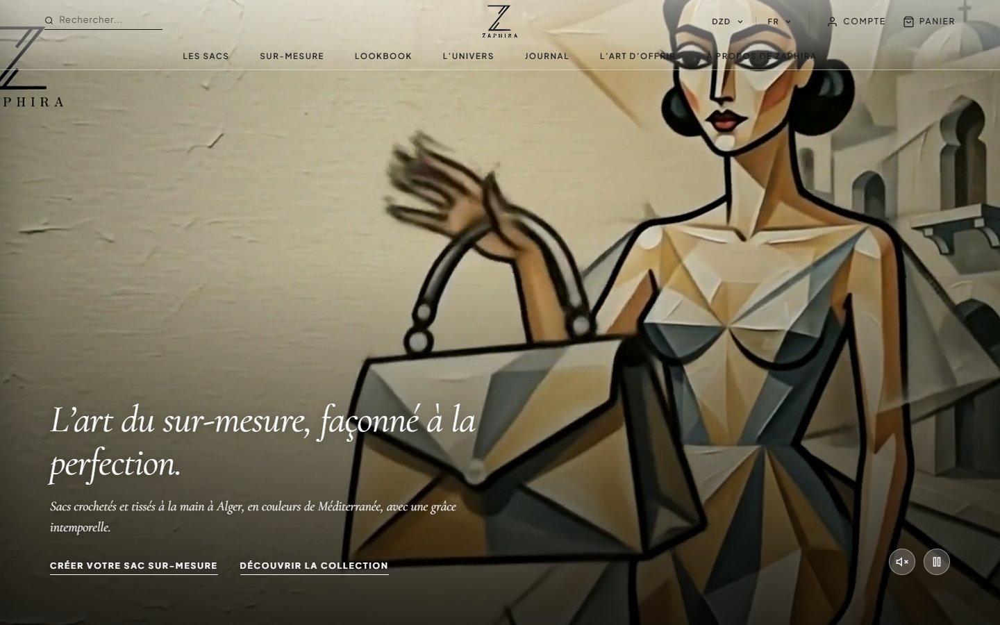
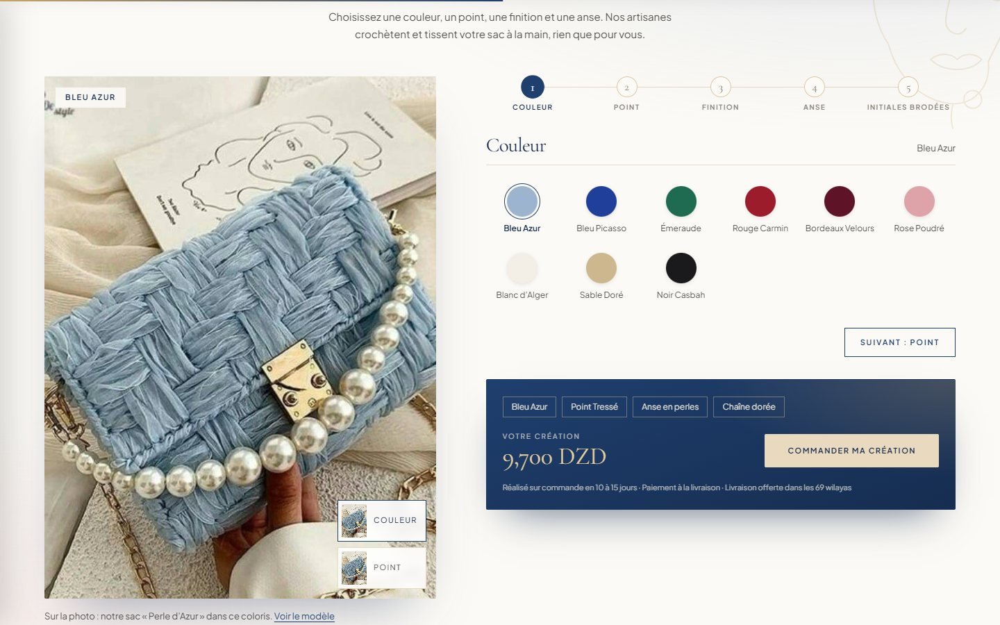
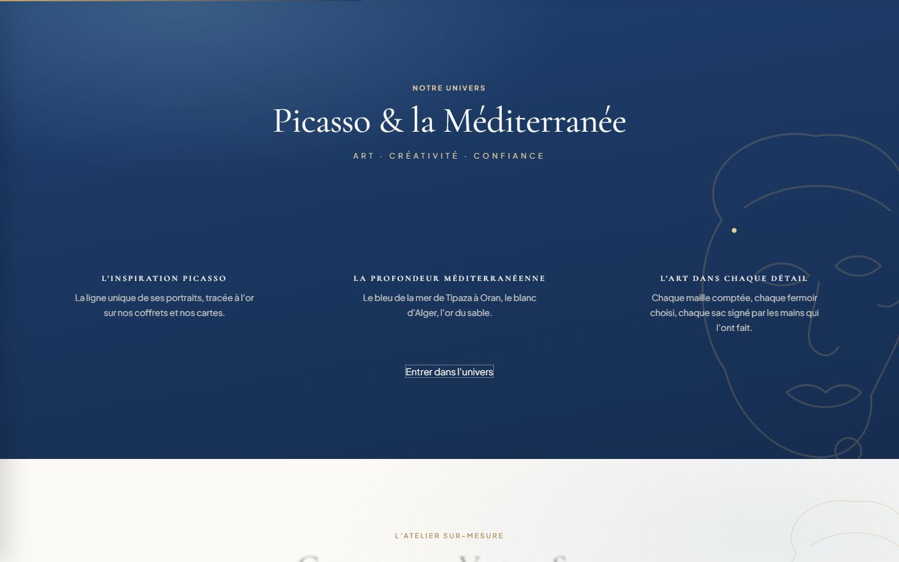
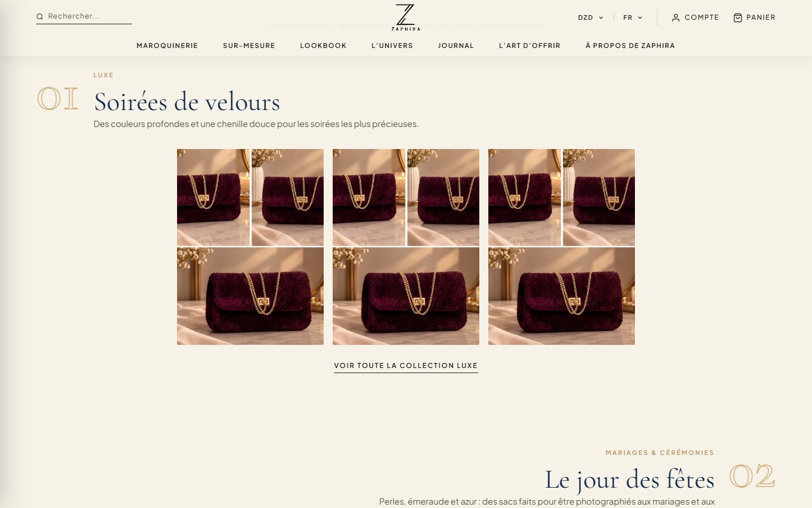
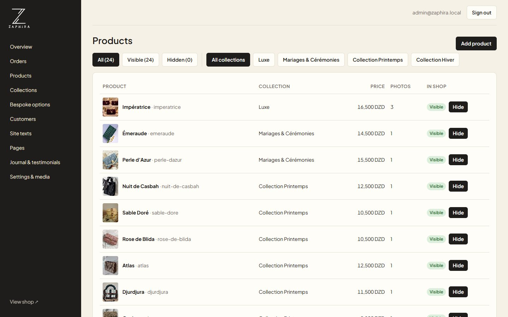
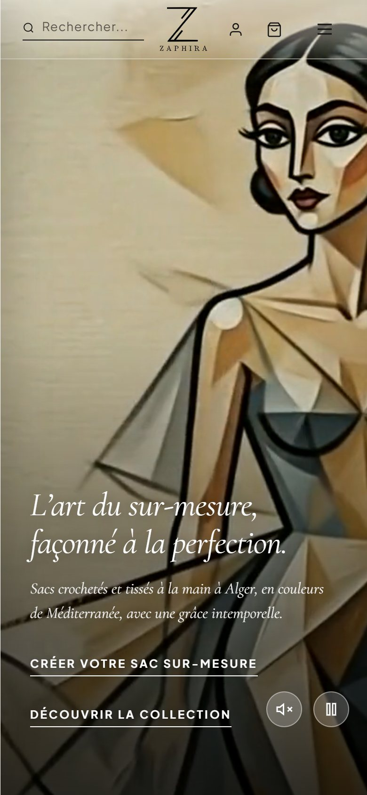
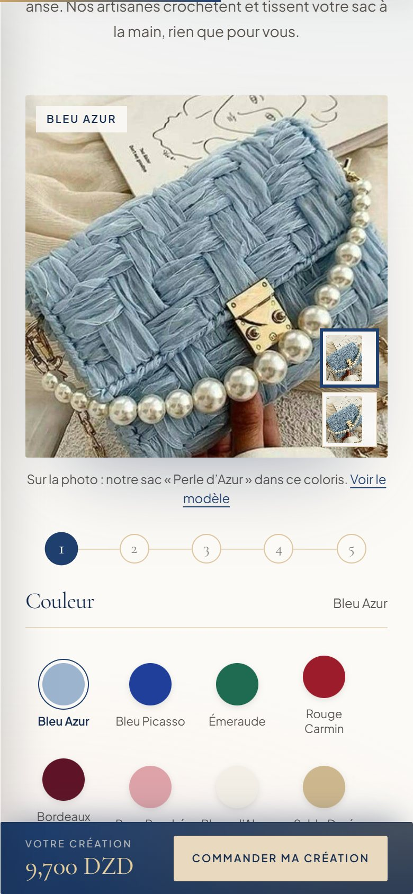
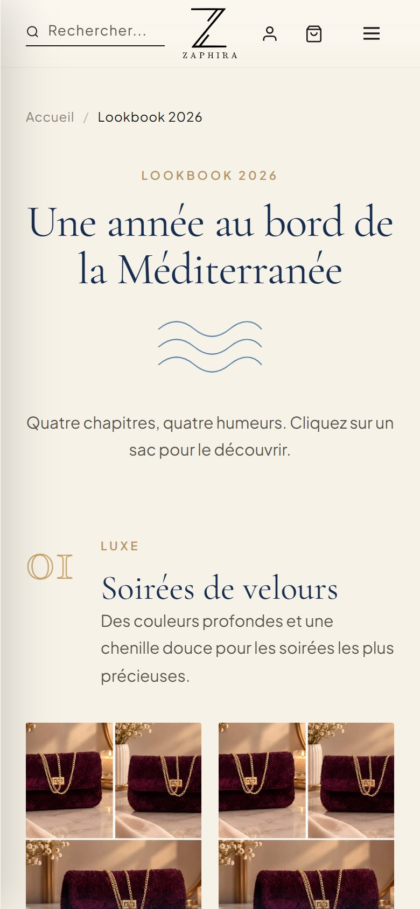
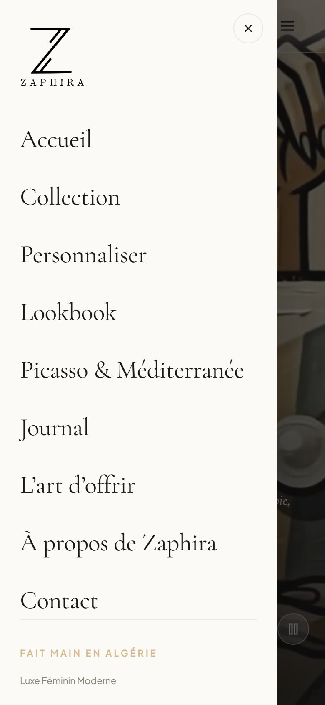

<div align="center">

<picture>
  <source media="(prefers-color-scheme: dark)" srcset="portfolio/logo/zaphira-logo-cream.svg">
  
</picture>

# Maison Zaphira

**Handmade luxury bags from Algiers — Picasso & the Mediterranean.**

*Art · Créativité · Confiance*


-1F3F6E)

</div>

<p align="center">
  
</p>

Zaphira is the online house of an Algerian brand of handmade bags: crocheted, woven and finished by hand in Algiers, with an identity drawn from Picasso's single line and the blues of the Mediterranean. This repository holds the full-stack shop — storefront, bespoke studio, checkout, customer accounts and a back office the owner uses to run everything without touching code.

---

## Highlights

| | |
| --- | --- |
| **Storefront in 3 languages** | French, English and Arabic (right-to-left), with prices in DZD, EUR or USD. |
| **Bespoke atelier** | Compose a bag step by step — colour, stitch, finishing touch, strap, embroidered initials — with a live photo of a real bag and a server-verified price. |
| **Checkout for Algeria** | Cash on delivery to all 69 wilayas, guest checkout, order tracking, email confirmations. |
| **Brand pages** | L'Univers (Picasso & the Mediterranean), Lookbook, L'Art d'offrir (gift packaging), Journal stories, About. |
| **Back office** | Orders, products and photos, collections, bespoke options, customers, every site text, pages, journal, contact numbers, media and tracking ids. |
| **Motion & craft** | Shared-element page transitions, scroll-drawn line art, curtain reveals — all off for visitors who prefer reduced motion. |
| **Privacy** | Cookie consent; Google Analytics and Meta Pixel load only after consent. |

<table>
  <tr>
    <td width="50%"></td>
    <td width="50%"></td>
  </tr>
  <tr>
    <td></td>
    <td></td>
  </tr>
</table>

<p align="center">
  
  
  
  
</p>

## Tech stack

| Layer | Choice |
| --- | --- |
| Framework | Next.js 16 (App Router, Cache Components, Server Actions, `proxy.ts`), React 19 (`ViewTransition`) |
| Language | TypeScript (strict) |
| Database | Turso (libSQL) with Drizzle ORM and versioned SQL migrations |
| Auth | Better Auth — email + password, 6-digit email codes, admin role, database-backed rate limits |
| Validation | Zod 4 |
| Email | Resend (printed to the console in development) |
| Uploads | Vercel Blob (local `public/uploads` in development) |
| Hosting | Vercel |
| Testing | Playwright end-to-end suites against the production build |

## Repository layout

```text
.
├── web/                 Next.js app — storefront, API and back office (all new work)
│   ├── src/app/[lang]/  Storefront routes (fr · en · ar)
│   ├── src/app/admin/   Back office
│   ├── src/db/          Drizzle schema, seed data
│   ├── drizzle/         SQL migrations
│   └── README.md        App guide: routes, admin, local setup, deployment
├── portfolio/           Logos, brand assets, screenshots and the project case study
├── index.html, css/, js/  Original static prototype (kept until the launch)
└── AGENTS.md            Engineering rules for contributors and AI agents
```

## Getting started

```bash
cd web
npm install
cp .env.example .env.local      # fill in the values (see below)
npm run db:setup                # migrations + catalogue + first admin account
npm run dev                     # http://localhost:3000
```

Leave `TURSO_DATABASE_URL` empty to work on a local SQLite file (`web/local.db`).

| Variable | Purpose |
| --- | --- |
| `TURSO_DATABASE_URL`, `TURSO_AUTH_TOKEN` | Turso database (production) |
| `BETTER_AUTH_SECRET`, `BETTER_AUTH_URL` | Session signing and public site URL |
| `ADMIN_EMAIL`, `ADMIN_PASSWORD` | First admin account, created by `npm run db:seed` |
| `RESEND_API_KEY`, `EMAIL_FROM` | Transactional email |
| `BLOB_READ_WRITE_TOKEN` | Image uploads from the back office |
| `CODPILOT_API_URL`, `CODPILOT_API_KEY` | Order hand-off to CodPilot (optional) |

Secrets live in `web/.env.local` (git-ignored) and in Vercel's environment settings — never in the repository.

### Useful scripts

| Command | |
| --- | --- |
| `npm run dev` / `build` / `start` | Develop, build, serve the production build |
| `npm run typecheck`, `npm run lint` | TypeScript and ESLint |
| `npm run db:generate` | New migration after a schema change |
| `npm run db:setup` | Apply migrations and seed (safe to re-run) |
| `npm run db:studio` | Browse the database |

## Deployment

1. Create the Turso database and a token; import the repository in Vercel with `web/` as the root directory.
2. Add the environment variables above in Vercel.
3. Run `npm run db:setup` once against the production database.

Full details: [`web/README.md`](web/README.md).

## Brand

Picasso blue `#1F3F6E`, Mediterranean blue `#5E86A8`, sand `#E8D9BF`, gold `#C9A46A` and powder pink `#DDA3A9`; Cormorant Garamond and Plus Jakarta Sans (Amiri and IBM Plex Sans Arabic in Arabic). Logos, packaging and the full guide are in [`portfolio/`](portfolio/).

---

<p align="center">
  <sub>© 2026 Maison Zaphira — Fait main en Algérie. All rights reserved.</sub>
</p>
