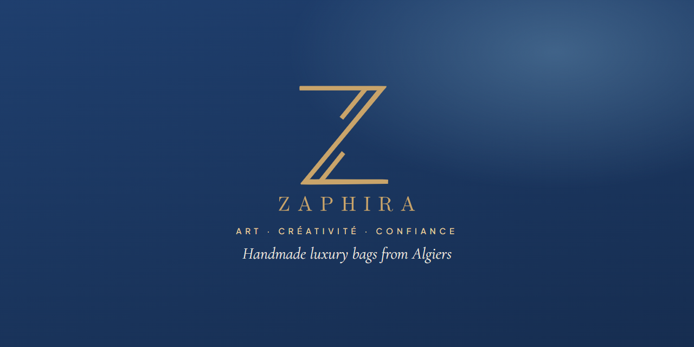
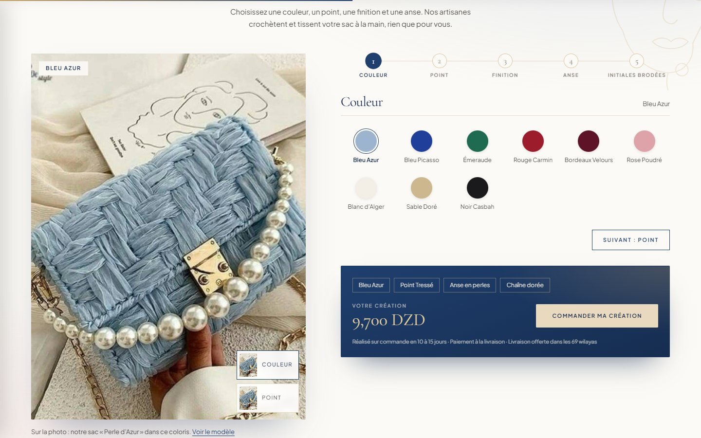
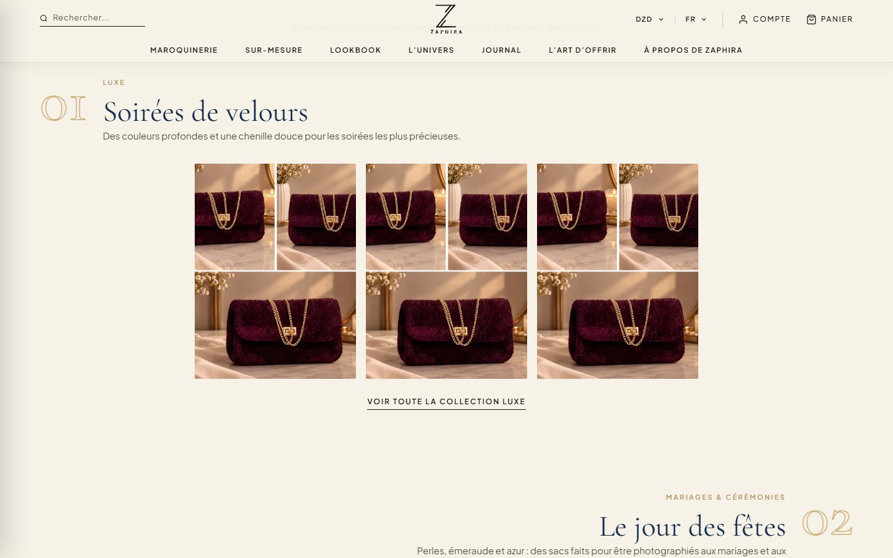
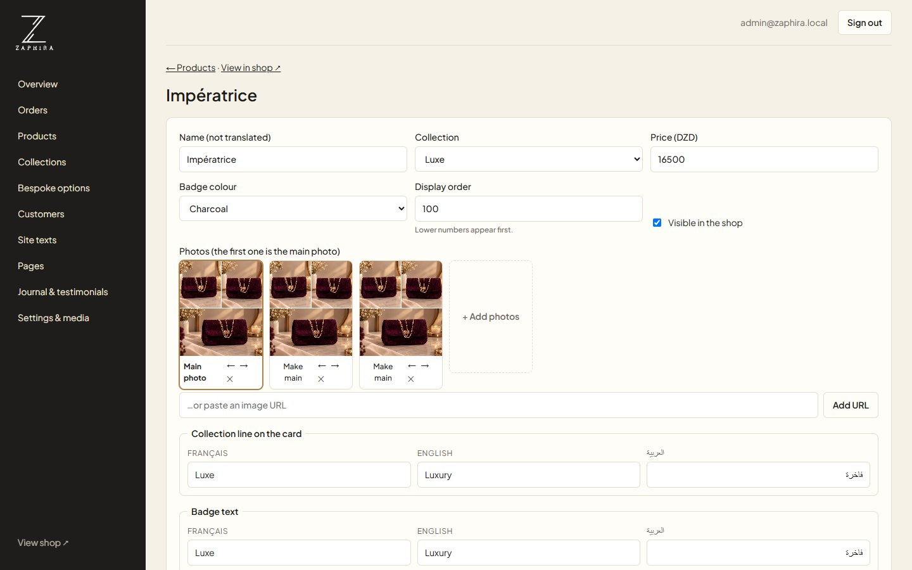
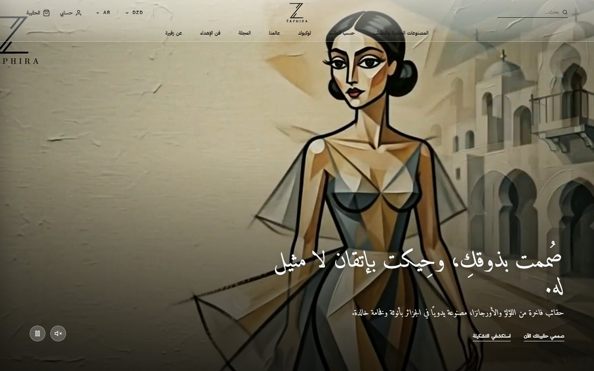

# Case study — Maison Zaphira

**Handmade luxury bags from Algiers — Picasso & the Mediterranean.**
Role: founder & full-stack developer · 2026 · Next.js 16, React 19, TypeScript, Turso, Drizzle, Better Auth, Vercel

---

## Context

Zaphira is an Algerian brand of handbags crocheted and woven by hand in Algiers — woven basket stitch, velvet chenille, bouclé, damier and chevron, finished with gilded clasps and chains. Its identity borrows Picasso's single-line portraits and the blues of the Mediterranean: Picasso-blue boxes, a beige ribbon, a gold Z.

The first version was a static HTML/CSS/JavaScript prototype. It looked the part, but it could not take real orders, had no back office, and every change of price, photo or phone number meant editing code.

## Goals

1. **Sell for real in Algeria** — cash on delivery to all 69 wilayas, orders the owner can follow up.
2. **Speak the clients' languages** — French, English and Arabic with a true right-to-left layout.
3. **Let clients make their own bag** — a configurator that feels like an atelier, not a form.
4. **Give the owner the keys** — products, photos, prices, texts, pages and media editable without a developer.
5. **Feel like a luxury house** — calm layouts, an identity of its own, refined motion, fast on phones.

## What was built

### Storefront
- Home with a Picasso-style hero video, a ribbon of house promises, shop-by-mood collections, the product grid, the bespoke atelier, the art of giving and journal stories.
- Collection pages with sorting, product pages with galleries, search across all three languages.
- Bag and three-step checkout; orders are re-priced on the server and stored with a snapshot of each line.
- Customer accounts with six-digit email codes, guest order tracking, eight information pages (delivery, FAQ, care, contact, terms, privacy, legal, accessibility).

### Bespoke atelier
A five-step configurator — colour, stitch, finishing touch, strap, embroidered initials. The large photo always shows a **real Zaphira bag** in the chosen colour or stitch, a strip switches between the two, and the embroidered initials appear on the photo. The price shown in the browser uses the same pricing module as the server, but the server recomputes every order from the database. On phones, choices become swipeable rows and the price bar stays pinned to the bottom of the screen.

### Brand pages
- **L'Univers** — Picasso & the Mediterranean: three chapters, the house palette, six hand-drawn motifs that trace themselves on scroll.
- **Lookbook 2026** — one chapter per collection, generated from the live catalogue.
- **L'Art d'offrir** — the Picasso-blue packaging and gift ideas by budget.
- **Journal** — stories with photo galleries and the bags that appear in them.

### Back office
Orders (status, internal notes, CodPilot hand-off), products with drag-ordered photo galleries and uploads, collections, configurator options and prices, customers, **every interface text in three languages**, information pages, journal and testimonials, contact numbers (which switch on the WhatsApp button), social links, hero video and images, Google Analytics and Meta Pixel ids.

## Technical decisions

| Decision | Why |
| --- | --- |
| **Next.js 16 with Cache Components** | Catalogue and content are cached with tags; every admin save invalidates exactly what changed, so the shop stays fast and edits appear immediately. |
| **Turso + Drizzle** | SQLite semantics with a hosted edge database; a typed schema and versioned SQL migrations. A local SQLite file in development. |
| **Localized JSON columns** | Every customer-facing text is stored as `{ fr, en, ar }`; interface strings are JSON dictionaries the owner can override from the back office. |
| **Server is the price authority** | A shared pricing module for instant feedback in the browser, but orders are always recomputed from the database. |
| **Better Auth** | Hashed passwords, email verification codes, an admin role checked on every admin page and action, database-backed rate limits. |
| **Consent-gated analytics** | Analytics and advertising scripts load only after an explicit choice, stored in a first-party cookie. |
| **Progressive motion** | React `ViewTransition` for the product-photo morph, CSS scroll-driven animations where supported, IntersectionObserver reveals elsewhere, and a full `prefers-reduced-motion` fallback. |

## Challenges & how they were solved

- **Right-to-left Arabic.** Layouts use logical properties (`inset-inline-start`, `margin-inline`), Arabic fonts are loaded per language, and the language switch performs a full load because each language has its own root layout.
- **Reveal animations that never fired.** Clipping the observed element hid it from the IntersectionObserver; the curtain moved onto the image inside the frame.
- **Phone layout of the configurator.** Swipeable rows made the grid column grow wider than the screen (min-content sizing); `minmax(0, 1fr)` fixed it, and `overflow: clip` instead of `hidden` kept the price bar sticky.
- **Mobile menu taps going nowhere.** The overlay was stacked above the drawer; the drawer now sits above its own backdrop, guarded by an automated test.
- **Owner autonomy.** Anything the owner may want to change — from the hero video to a single button label — lives in the database, not in code.

## Quality

- TypeScript strict, ESLint, production build on every change.
- Playwright suites against the production build: storefront and checkout, brand pages, information pages and tracking, back office, cookie consent — about 150 checks.
- A responsive audit of 17 pages at 360, 768 and 1024 px, plus phone-specific checks for the configurator and the menu.

## Results

- A complete shop ready for launch: 24 handmade bags in 4 collections, 22 configurator options, 3 languages, 69 wilayas.
- The owner runs catalogue, orders, content and media from the back office.
- A distinctive identity — Picasso blue, gold line art, Mediterranean palette — consistent from the hero to the packaging.

## Next steps

Deployment on Vercel with a custom domain, CodPilot order hand-off once the API is available, and online payment alongside cash on delivery.
